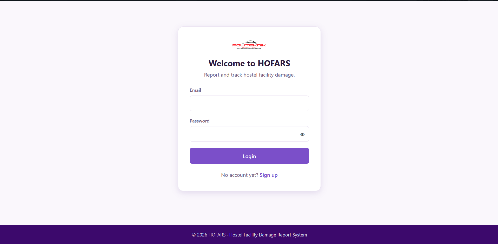
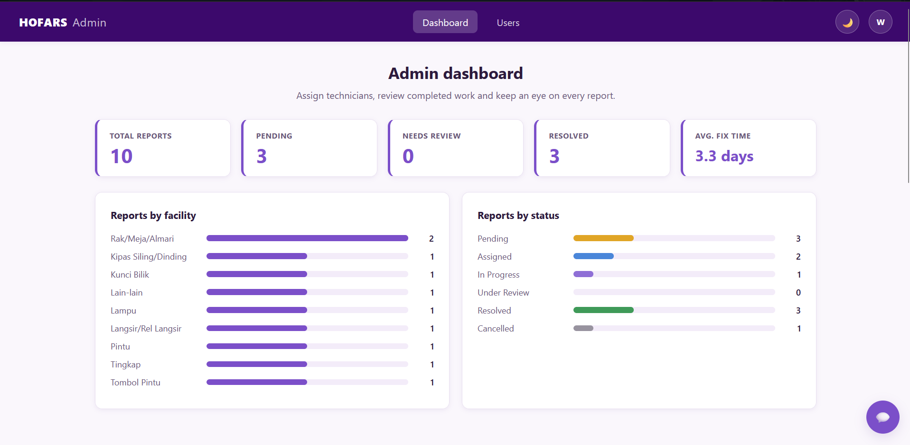
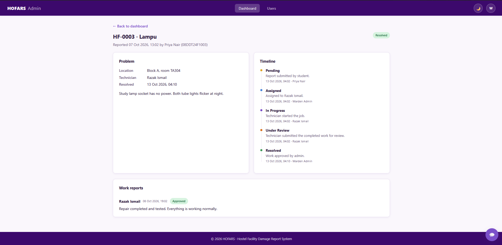

# HOFARS: Hostel Facility Damage Report System

A role-based web app for reporting, assigning and tracking hostel facility repairs.
Students report broken facilities, an admin assigns technicians, technicians upload proof of the repair, and the admin reviews and closes each job.

Built with **PHP 8 (no framework), MySQL/MariaDB (PDO), vanilla JavaScript and plain CSS**, as a final year project.

<!-- Add screenshots here: docs/login.png, docs/admin-dashboard.png, docs/report-detail.png -->





## Features

**Students**
- Sign up, log in, report damage with an optional photo
- See all their reports with status filters, a full status timeline and technician proof
- Cancel a report while it is still pending

**Technicians**
- See only the jobs assigned to them, with the ones needing action listed first
- Start a job, post progress notes, and upload photos or videos as proof
- Send a finished job to the admin for review

**Admins**
- Dashboard with totals, average fix time, reports by facility and reports by status
- Search, filter and paginate all reports
- Assign or reassign technicians
- Approve completed work (closes the report) or send it back with a note
- Create technician and admin accounts

**General**
- Dark mode, responsive layout
- **Help assistant**: a chat button (bottom-right) that answers "how do I…?" questions for the user's role. Built-in help always works; add a Claude API key to get AI answers (see below)
- Profile page: username, matric number, profile picture, password change

## Report lifecycle

```
Pending → Assigned → In Progress → Under Review → Resolved
   ↓                       ↑______________|  (admin sends it back)
Cancelled (by student, only while Pending)
```

Every change is recorded in a timeline shown on the report page.

## Security

- Passwords hashed with `password_hash`; password hashes never leave the server
- All queries are prepared statements; all output is escaped
- CSRF token on every form; session ID regenerated on login; `HttpOnly` + `SameSite` cookies
- Login throttling (5 failed attempts → 60 second lock)
- Public sign-up can only create **students**; staff accounts are created by an admin
- Role checks on every page; users can only open reports they own or are assigned to
- Uploads: real MIME type checked, size limited, stored under random names outside direct web access (`.htaccess`), and served only through `download.php` after an access check
- Database credentials live in `.env` (not in the repo)

## Setup (Laragon / XAMPP)

1. Copy this folder to `C:\laragon\www\hofars` (or your web root).
2. Create the database and tables. Either run
   `mysql -u root -p < database/schema.sql`
   or import `database/schema.sql` with phpMyAdmin / HeidiSQL.
3. Copy `.env.example` to `.env` and put in your MySQL username and password.
4. (Optional) Load fake demo data from a terminal in the project folder:
   `php database/seed.php`
5. Open `http://hofars.test/` (Laragon) or `http://localhost/hofars/`.

### Demo accounts (after running the seed)

Password for all accounts: `Demo@1234`

| Role | Email |
|---|---|
| Admin | admin@hofars.test |
| Technician | tech1@hofars.test, tech2@hofars.test |
| Student | aisyah@hofars.test, daniel@hofars.test, priya@hofars.test, hafiz@hofars.test |

### Optional: AI chatbot

The chat button works out of the box with built-in answers (keyword matching), no setup needed. To switch on AI answers:

1. Create an API key at https://platform.claude.com and add it to your `.env`:
   ```
   ANTHROPIC_API_KEY=your-key-here
   ```
2. If you imported `schema.sql` before the chatbot existed, run `database/migrations/001_chat_usage.sql` once. It adds a small table that counts AI calls (new installs already have it).
3. Reload the site. The chat header now says "AI assistant".

How it behaves:
- The AI only sees the user's **role** and a fixed list of facts about the system. It never receives names, emails or report contents, and it cannot change any data.
- Usage is capped by `CHAT_HOURLY_LIMIT` (per user, default 30) and `CHAT_DAILY_LIMIT` (all users, default 300). Over the cap, or if the API is down or unreachable, the assistant quietly falls back to the built-in answers.
- The key stays on the server in `.env`; the browser never sees it. `CLAUDE_MODEL` defaults to a small, inexpensive model.

Without the seed, sign up as a student on the login page. To create the first admin, run the seed or insert one admin row manually.

## Project structure

```
index.php                 login + sign-up
student_hofars.php        new report / my reports
technician_hofars.php     assigned jobs
admin_hofars.php          dashboard, filters, assignment
admin_users.php           create staff accounts
report.php                report detail, timeline, work reports, review actions
profile.php               profile + password
download.php              access-checked file serving
hofars-help.php                  JSON endpoint behind the chat widget
includes/bootstrap.php    config, DB, session, security helpers
includes/layout.php       shared header / footer (+ chat widget)
includes/chatbot.php      built-in FAQ, Claude API call, usage limits
database/schema.sql       tables + facility list
database/seed.php         fake demo data (CLI only)
database/migrations/      small upgrade scripts for existing databases
assets/                   style.css, app.js, hofars-assistant.js
```

## Troubleshooting

Turn on `APP_DEBUG=true` in `.env` to see the real error instead of "Something went wrong", and turn it off again afterwards.

| Error | Cause and fix |
|---|---|
| `Access denied for user 'root'` | `DB_PASS` in `.env` is missing or wrong. |
| `Unknown column …` / `Table … doesn't exist` | An old `hofars_db` is still in place. Drop it and re-import `database/schema.sql`. |
| Chat says "Built-in help" although a key is set | Key not in `.env`, `curl` extension off, or `chat_usage` table missing (run the migration). Check PHP's error log. |
| Log shows `SSL certificate problem` (Windows) | PHP can't verify HTTPS. Download `cacert.pem` and set `curl.cainfo` in `php.ini`. Don't disable verification. |

## Deploying a live demo

Any PHP 8 + MySQL host works (for example Netlify).
Upload the files, import `schema.sql`, create `.env`, set `APP_DEBUG=false`, and serve over HTTPS.
Make sure the `uploads/` folder is writable and that your host honours `.htaccess` (Apache).
On Nginx, add a rule denying direct access to `/uploads/`.

## Ideas for next steps

- Email or in-app notifications on assignment and resolution
- Password reset by email
- Export reports to CSV or PDF
- Automated tests
